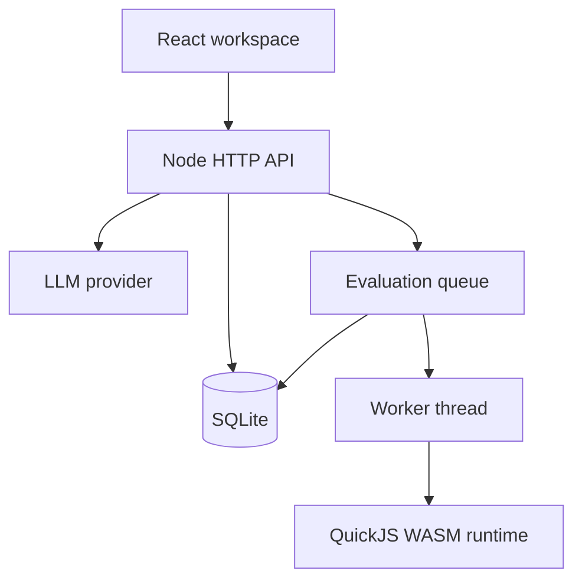
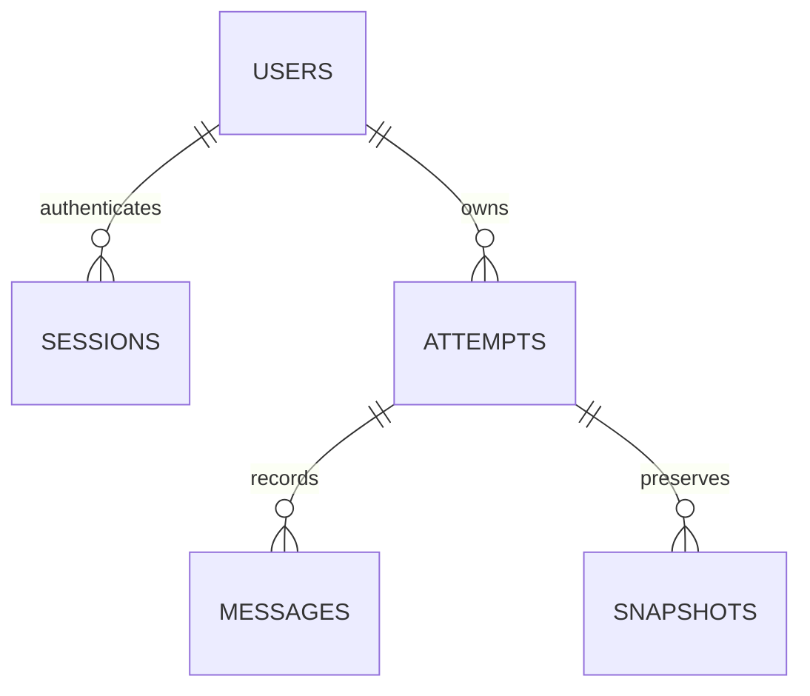
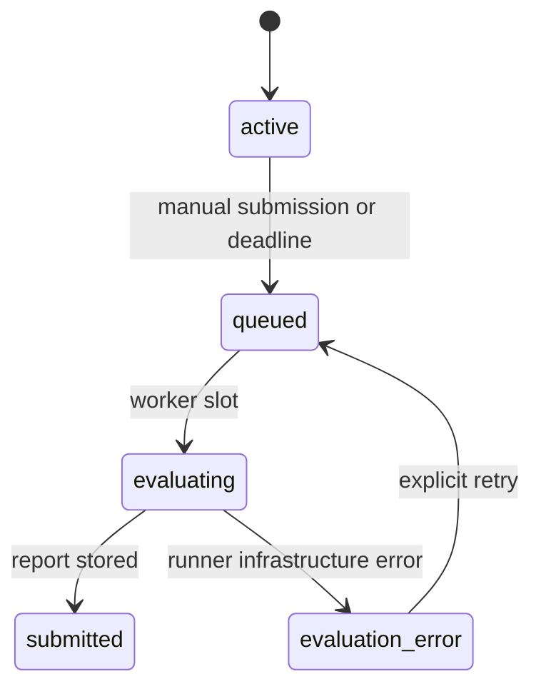

# Architecture and decisions

## Components

The API is the authority for identity, ownership, attempt state, deadlines, model allowlists, submissions and score calculation. Browser state is not a trusted source for scoring or time. The database is local and durable. The dev frontend proxies API traffic to keep cookie flows same-origin.

SQLite is intentionally selected for a zero-account, zero-subscription local setup. It is a different choice from the earlier proposed Supabase option. Tables are relational and map cleanly to a future PostgreSQL migration, but the current application does not include a Supabase adapter.

## Data model

`attempts` stores challenge ID/version, difficulty, server start/deadline, model ID, status, draft/submitted code, explanation, revision, AI request count and report JSON. New senior challenge IDs are distinct from legacy version-1 IDs. The combined catalogue resolves historical attempts without resetting the database. Generated hidden suites are deterministically seeded from attempt ID; public examples are fixed.

`messages` stores completed user/assistant exchanges, not credentials. Each successful explicit application can be saved through the normal draft pipeline; snapshots are taken for manual submissions. Current draft saves are in-place; this is not a full edit-by-edit replay system.

## Attempt state machine

Submitted code is immutable. Editing, example runs and AI requests are accepted only while active and before the deadline. An in-flight AI answer can finish after expiry; it is saved as conversation but does not change submitted code. Repeated submit requests return the authoritative attempt instead of replacing it.

On restart, `evaluating` jobs become `queued`, then all queued jobs and expired active attempts are processed. Two evaluation jobs can run concurrently in one server process. A deployment with multiple server processes needs transactional job claiming and shared admission controls; it is outside this local release.

## Evaluation boundary

Each test gets a fresh QuickJS WASM runtime in a Node worker thread. No host functions are exposed. Candidate code has standard JavaScript and JSON, but no Node objects, DOM, filesystem, network, external package imports or timers. Submitted CommonJS modules are resolved in the same isolated VM from in-memory workspace source strings, with no host callbacks. A runtime gets 64 MB memory, a 1 MB stack budget and a 750 ms regular / 2,000 ms workload interrupt. Parent-side total timeouts terminate stalled workers. Workers also have a JS heap budget.

Actual values are compared to expected values in the host using deep equality. Only the runner is given hidden inputs, not the browser or AI context. Raw hidden outputs and errors are redacted before storing the report. This prevents ordinary feedback disclosure; local source owners can still read fixtures. WASM/worker limits do not replace dedicated hostile-workload infrastructure for a public multi-tenant service.

The 40-case senior suite combines fixed adversarial regressions, per-attempt seeded generated tests, and bounded workload execution. It has task-specific security checks, not a generic vulnerability scanner or static analyzer. Workload limits are enforced, but are not CPU-complexity proofs. AST review is separate and mainly advisory; line count does not control the score. Dependency scanning, browser rendering and calibrated cross-machine benchmarks remain outside this release.

## AI boundary

An app-owner-configured provider adapter supports Gemini `generateContent` or an OpenAI-compatible `chat/completions` endpoint. Model choice is restricted to a configured list. API credentials are read server-side from environment variables and never returned by `/api/config`.

The prompt contains the public contract, saved code and a bounded recent conversation. Hidden tests and references are excluded. Candidate text/code is untrusted and never gains authority over grading. The assistant proposes file-specific replacements; each is reviewed and applied independently. Existing files and the public contract are sent as context, not hidden tests. The model is instructed to follow the request and avoid unsolicited expansion, but model behaviour is probabilistic. Its output is never treated as evidence that tests passed.

The deployment owner controls provider allowlists, cost and logging. AI conversations include candidate code and are sent to the selected external provider when the user presses send.

## Authentication and local protections

- Passwords: per-account random salt with Node scrypt; never stored in plaintext.
- Sessions: random 256-bit token in HttpOnly SameSite=Strict cookie; only its SHA-256 digest stored server-side, seven-day expiry.
- All attempt actions check ownership.
- Parameterized SQL and field/size validation.
- Browser mutation Origin check, request limits, AI allowance and concurrent-run controls.
- Production static responses include CSP, nosniff, frame and referrer protections.
- HTML is rendered through React escaping; AI text is displayed as text, not injected HTML.
- No password recovery, verification mail, public admin panel or billing service in this version.

## Future deployment decision

Single persistent Node instance plus a mounted disk is the simplest deployment preserving this exact code. Supabase/PostgreSQL is preferable when adding multiple API instances, durable distributed jobs or managed backups. That migration needs replacing SQL dialect details, session storage and job locking together; changing a connection string alone is not enough.
